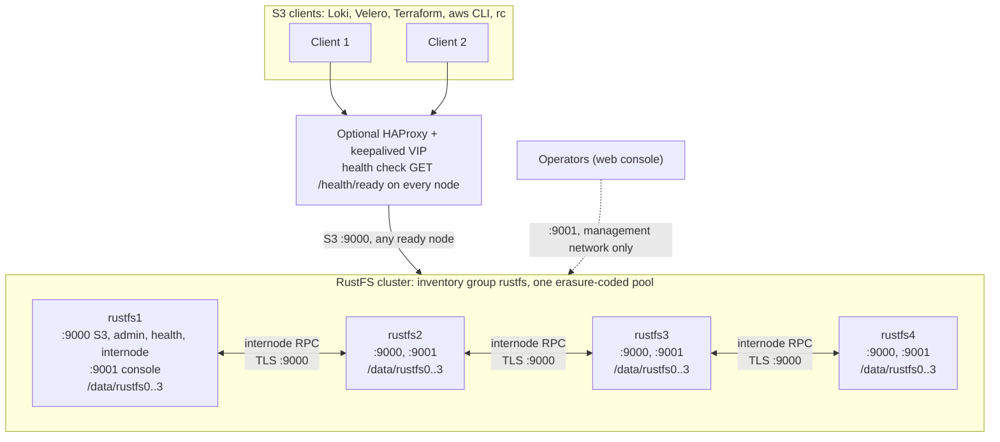
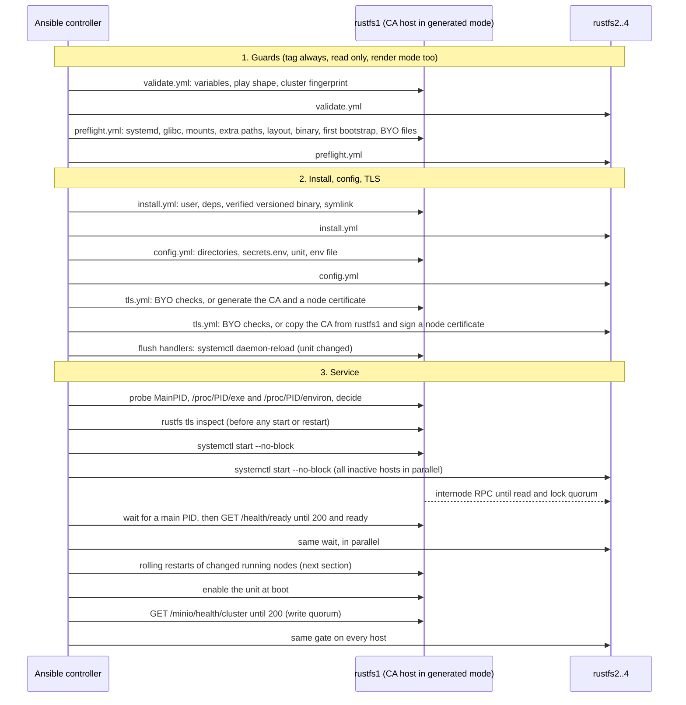
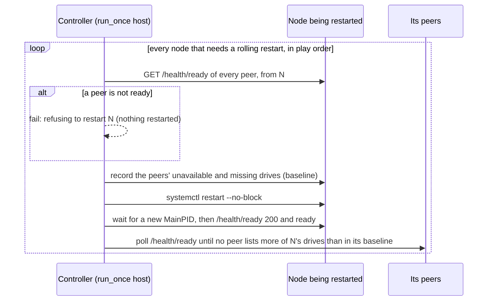

# Architecture

This document describes the RustFS topology the role deploys, how one run
flows, how the role decides when and how to restart nodes, and what the
Molecule scenarios proved about the systemd sandbox.

---

## Topologies

The role deploys three upstream topologies with one variable interface:
single node single drive (SNSD, `["/data/rustfs0"]`), single node multiple
drives (SNMD, `["/data/rustfs{0...3}"]`) and multiple nodes multiple drives
(MNMD, `["https://rustfs{1...4}.example.com:9000/data/rustfs{0...3}"]`). The
picture shows MNMD with four nodes and an optional load balancer; SNSD and
SNMD are the same picture with a single node and no internode traffic.

**Key design points:**

- **One port per node for everything but the console.** `rustfs_address`
  (`:9000`) serves S3, the admin API, the health endpoints and the
  internode RPC; it must be the same port on every node, and every node
  talks to every other node on it (the picture shows neighbours only). The console has
  its own listener (`rustfs_console_address`, `:9001`), which listens on all
  interfaces by default: bind it to a management address or firewall it.
- **One volume string for the whole cluster.** `rustfs_volumes` is rendered
  into `RUSTFS_VOLUMES` byte for byte on every node. The host names in it
  are the node addresses: by default they equal the inventory names of the
  `rustfs` group, which is also `rustfs_cluster_hosts`. The role refuses a
  play in which a node's cluster-wide variables differ (fingerprint), and
  refuses a changed layout on a running cluster (layout guard).
- **One certificate per node.** It serves S3, console and internode traffic
  and needs a SAN for the node's host name in `rustfs_volumes`. Peers trust
  each other through `ca.crt` in `rustfs_tls_dir` (or the OS store with
  `rustfs_tls_trust_system_ca`). RustFS reloads replaced certificate files
  by itself, so certificates never cause a restart.
- **The load balancer is optional.** Clients can talk to any node. A load
  balancer that health-checks `/health/ready` stops sending traffic to a
  node while it restarts. See
  [INTEGRATION.md](INTEGRATION.md#haproxy-in-front-of-the-cluster).
- **Erasure coding is per pool.** RustFS picks the erasure set width and the
  parity from the drive count of each pool. How many node failures a pool
  survives depends on how its sets spread over the nodes, not only on the
  parity. Upstream documents a minimum of four nodes for MNMD; the role does
  not assert it, because the binary validates smaller layouts itself.
- **Drives are mount points.** Every data dir must be a mounted drive
  (`rustfs_require_mounted_drives`), and the unit carries
  `AssertPathIsMountPoint` for each, so a node never writes object data to
  its root disk, during a run or after a reboot.

---

## Run sequence

One run of the role against a new four-node cluster. All hosts run every
task in parallel (the default linear strategy); `serial` is refused.

**Notes:**

- **Guards first, and read only.** `validate.yml` (variables and the play
  shape) and `preflight.yml` (the host) run before anything is touched and
  are tagged `always`. A host that fails one is left exactly as it was. The
  TLS checks of BYO material that need `python3-cryptography` run in the TLS
  stage; a host that fails there has new files on disk but is not
  restarted.
- **Install once per version.** When the versioned binary
  `rustfs-<version>-<libc>` exists, nothing is downloaded and no temporary
  directory is created. Otherwise the zip is downloaded into a temporary
  directory inside `rustfs_bin_dir`, checked against a pinned or given
  SHA-256 (upstream publishes no signatures), and the extracted binary must
  report `rustfs_version` before it is installed. The `rustfs` symlink then
  flips to it; running processes keep their old binary until they restart.
- **Two env files.** The non-secret `rustfs_env_file` is diff-able and
  backed up; `secrets.env` (`root:root 0600`) holds the credentials. Both
  are rendered from the same dictionaries (`vars/main.yml`) that the restart
  decision compares with the running process.
- **Parallel, non-blocking start.** RustFS reports `READY=1` to systemd only
  after it has read and lock quorum, so the first node of a cold cluster
  cannot finish starting before its peers run. All inactive nodes are
  started with `--no-block` in the same task; the role then waits for each
  node's own `/health/ready`, and finally for write quorum. The unit has
  `TimeoutStartSec=infinity`, so a node that waits for its peers is never
  killed by systemd.
- **Check mode** on a converged host changes nothing, skips every wait and
  reports pending restarts (for example after a `--tags config` run). It is
  not supported for a first install.

---

## Restart decision and rolling restart

There is no `restart rustfs` handler. A notified handler is lost when a run
dies between rendering a file and the flush, and it cannot choose between
restarting one node at a time and restarting all changed nodes together.
Instead, every run compares each node's running process with the desired
state:

- **Binary:** `/proc/<MainPID>/exe` must be the versioned binary of
  `rustfs_version`.
- **Environment:** `/proc/<MainPID>/environ` (the environment systemd built
  from both env files when the process started) must hold every desired key
  with the desired value. The desired environment is the non-secret and the
  secret dictionary plus two non-secret markers in the env file:
  `ANSIBLE_RUSTFS_MANAGED_KEYS` (the sorted key names, so a removed key is a
  change) and `ANSIBLE_RUSTFS_UNIT_SHA256` (the digest of the unit file, so a
  unit change reaches the process).

The environment is read as root in a `no_log` task and never stored as a
fact; the decision keeps key names only. Because the decision is stateless,
a restart that an earlier run rendered but never performed (a
`--tags config` run, a run that died half way) happens on the next run, exactly
once, with the right mode:

| State of a node | What the role does |
|---|---|
| Not running (first bootstrap, stopped, crashed) | starts it, in parallel with the others |
| Running, same binary and environment | nothing |
| Running and changed: an env key or a secret (other than the two of the next row), the unit, or `rustfs_version` | rolling restart |
| Running and changed `RUSTFS_VOLUMES` (with `rustfs_allow_volumes_change`) or `RUSTFS_RPC_SECRET` | restarts the changed nodes together: old and new cannot coexist |
| Running and changed, `rustfs_rolling_restart: false` | restarts the changed nodes together |
| Still starting (not yet serving) and changed | restarts it together with the others |
| A certificate replaced | nothing: RustFS reloads it |

The rolling restart runs inside one play: an included task file
(`restart_node.yml`) with `run_once` and a loop over the changed nodes in
play order, so restart, wait and peer checks stay together per node. Every
task delegates to the node being restarted.

**Notes:**

- **Peers first.** A node goes down only when every peer is ready. A bad
  change or a dead peer therefore stops the rollout at one node at most.
  There is no skip list for a permanently dead peer: run with
  `rustfs_rolling_restart: false` in a maintenance window instead.
- **Re-admission, not just readiness.** A node's own `/health/ready` says it
  can reach the cluster, not that the cluster reaches it again. The next
  node goes down only after every peer has stopped listing more of the
  restarted node's drives as unavailable or missing than before (drive keys
  `poolIndex/setIndex/diskIndex` of `details.storage`), so a cluster that
  already has a dead drive can still be rolled.
- **`any_errors_fatal`.** A failure inside the `run_once` loop would
  otherwise fail only the `run_once` host while the other hosts carry on.
  The loop sits in a block with `any_errors_fatal: true`, so a failed
  rollout stops the play on every host. Re-running the play resumes it: the
  nodes that were restarted already match the desired state.
- **Why not `serial` or `throttle`.** `serial` breaks the first bootstrap
  (every node must start in the same run) and the consistency check, and it
  is refused. `throttle: 1` serialises each task separately, so the restart
  would run on every node before the first wait starts.
- **Timing.** In the four-node Molecule scenario a rolling restart takes
  about 10 s per node (restart, readiness, re-admission).

---

## Sandbox

The unit in `templates/rustfs.service.j2` starts from the upstream unit
(`deploy/build/rustfs.service`) and tightens it: `ProtectSystem=strict` with
`ReadWritePaths` templated from real paths (home, every data dir,
`rustfs_systemd_read_write_paths`), `ProtectHome`, `PrivateTmp`,
`PrivateDevices`, the `Protect*` kernel and clock directives,
`RestrictNamespaces`, `RestrictAddressFamilies=AF_INET AF_INET6 AF_UNIX
AF_NETLINK`, `LockPersonality`, `SystemCallArchitectures=native`, and empty
capability sets unless a listener port is below 1024. `SystemCallFilter` and
`MemoryDenyWriteExecute` are deliberately not used (unverified against the
io_uring read path and the allocator).

Results of the `default` scenario (one node, four drive directories,
generated TLS, real start and S3 round trip), observed on Debian 12 under
Docker Desktop (arm64); the verify asserts behind every row also pass on
Debian 13 and Ubuntu 24.04:

| Question | Result |
|---|---|
| Does the unit start and serve unchanged? | Yes. No path was added and no directive was dropped. `systemd-analyze verify` reports nothing, `systemd-analyze security rustfs` rates the unit 3.1 ("OK"). |
| Does RustFS write outside the listed paths? | No. The only paths owned by the service user are the home and the data dirs; RustFS keeps its metadata in `<data dir>/.rustfs.sys`. The journal shows no permission or read-only error. |
| Does RustFS serve data from directories on the container's overlay root filesystem? | Yes, with `rustfs_unsupported_fs_policy: "warn"`: it logs `Unsupported filesystem type detected ... (overlayfs)` at WARN and continues. The scenarios therefore use plain directories, not Docker volumes. Production keeps the default `fail`. |
| Does RustFS change the owner or mode of its drive roots at startup? | No. The drive roots stay `rustfs:rustfs 0750`, and the idempotence step is green. |
| Does systemd change secret values on their way from `secrets.env` into the process? | No. The test secret `molecule-secret $#'key-0123456789` (a space, `$`, `#` and `'`) reaches `/proc/<pid>/environ` byte for byte, S3 SigV4 requests authenticate with it, and the restart decision sees no difference on the next run. Inside a double-quoted `EnvironmentFile` value systemd only interprets `"`, `\` and line breaks, which validation already refuses. |
| Does the extra file `ca.key` in the TLS directory disturb RustFS? | No. RustFS scans only sub-directories of the TLS path for per-domain material and ignores plain files; `rustfs tls inspect` reports `single-cert/default`. |

The `distributed` scenario (four nodes with two drive directories each,
internode TLS with one generated CA) runs the same unit unchanged: every node
starts, serves S3 through any node, and passes `systemd-analyze verify`;
internode RPC over HTTPS needs no extra path, address family or capability.
